# Описание работы · ТЗ № ТЗ-06/2026 · «08» октября 2026

**Исполнитель:** Кононова Ника, группа РПО3
**Сайт:** https://tz-06-vetklinika-lapadok.vercel.app
**Период проверок:** 08.10.2026 — 29.10.2026

## 1. Задача заказчика

Компания «ЛапаДок» получает заявки из 1 500, но не знает, какой канал приводит
клиентов. В сентябре 2026 года было 410 обращений, потеряно 256 (письмо директора в ТЗ).
Задача — сайт, на котором видно источник каждого посетителя, и одна
таблица со всеми заявками.

## 2. Схема работы

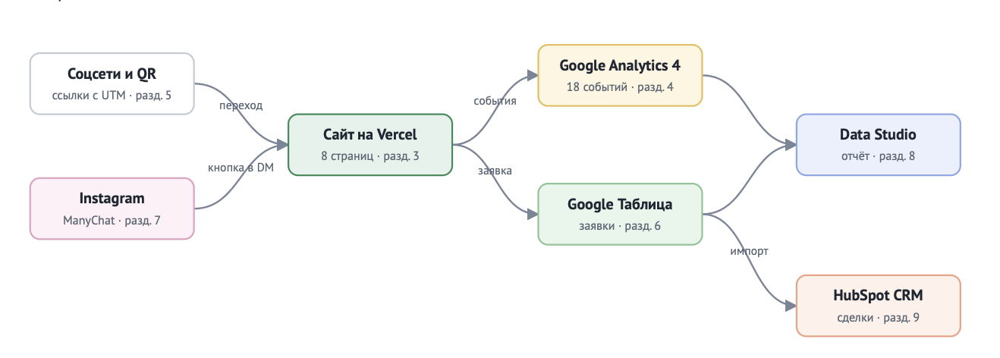

Посетитель приходит из соцсетей или по QR-коду по ссылке с UTM-метками.
Сайт отправляет события в GA4, а заявку — в Google Таблицу через Apps Script.
Данные GA4 и таблицы собираются на дашборде DataLens.

<!-- Схему можно взять со страницы 3 ТЗ или нарисовать. Ниже готовый вариант на Mermaid: оставьте его или удалите. -->

Схема на Mermaid

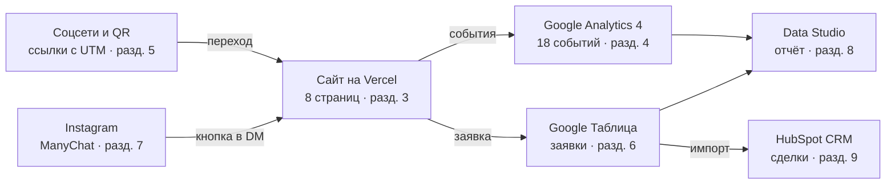

## 3. Сайт

Сайт из 8 страниц создан с помощью DeepSeek и доработан вручную: добавлены отслеживание действий пользователей и сбор рекламных меток из адреса страницы.
Опубликован на Vercel, обновляется после каждого push.

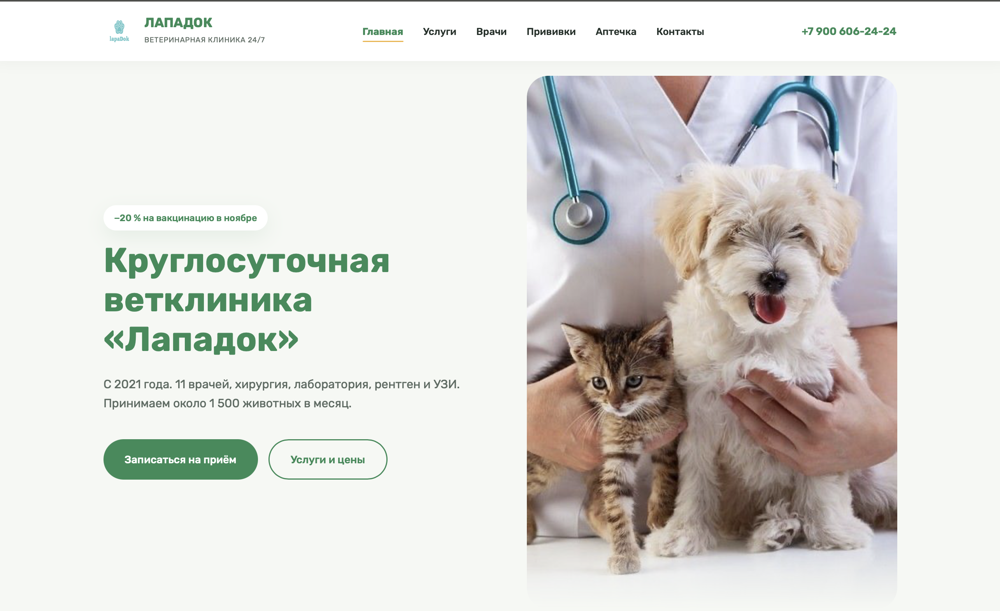
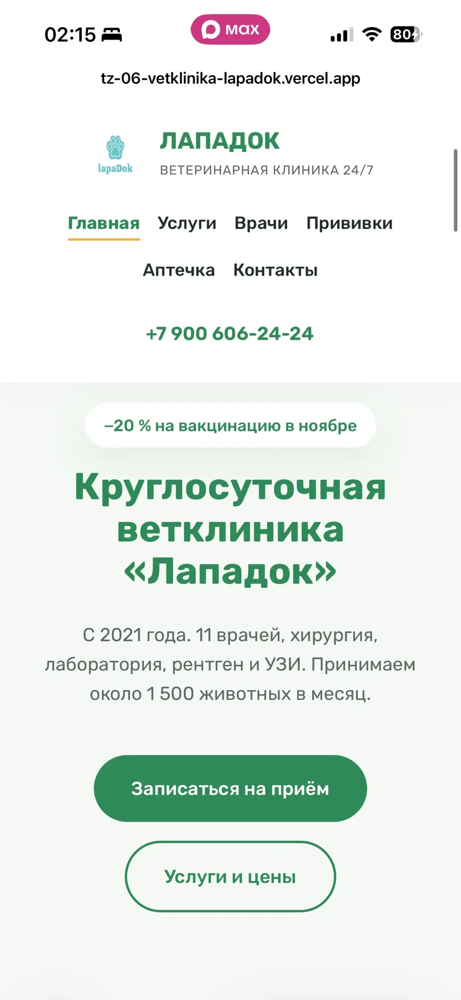
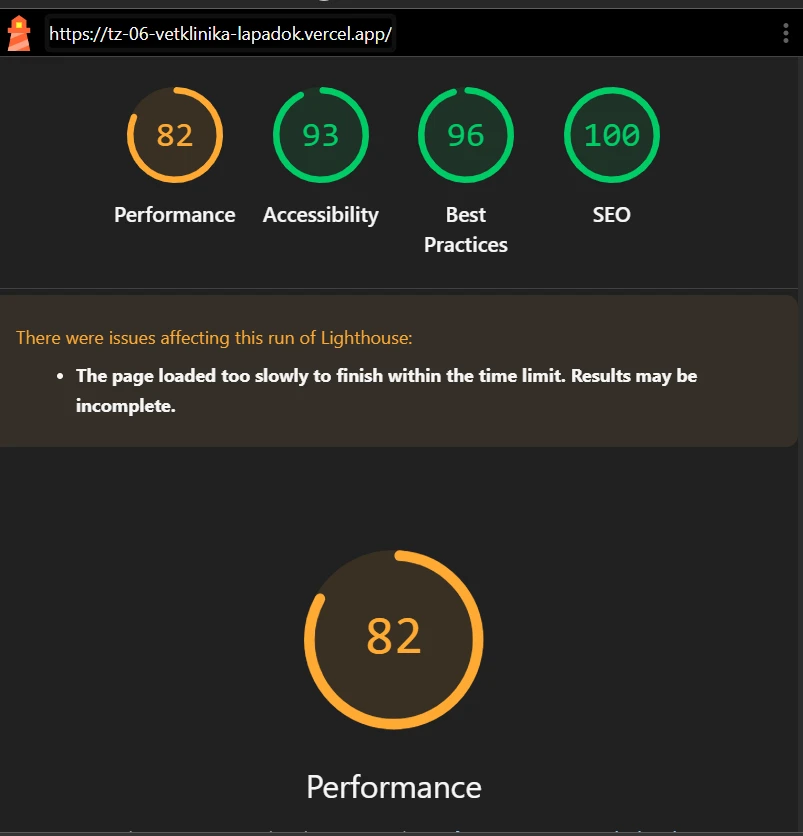

## 4. Аналитика GA4

Настроено 20 событий, из них своих — 14. Ключевые события: generate_lead, contact_click, messenger_click.
Каждое событие проверено в DebugView.

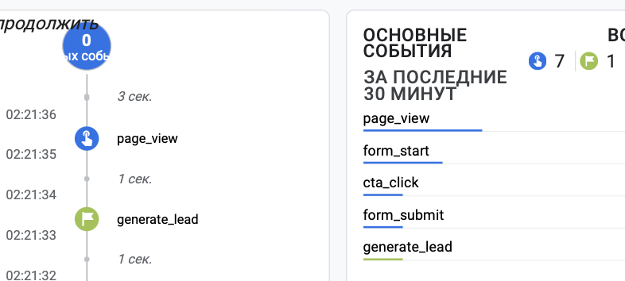
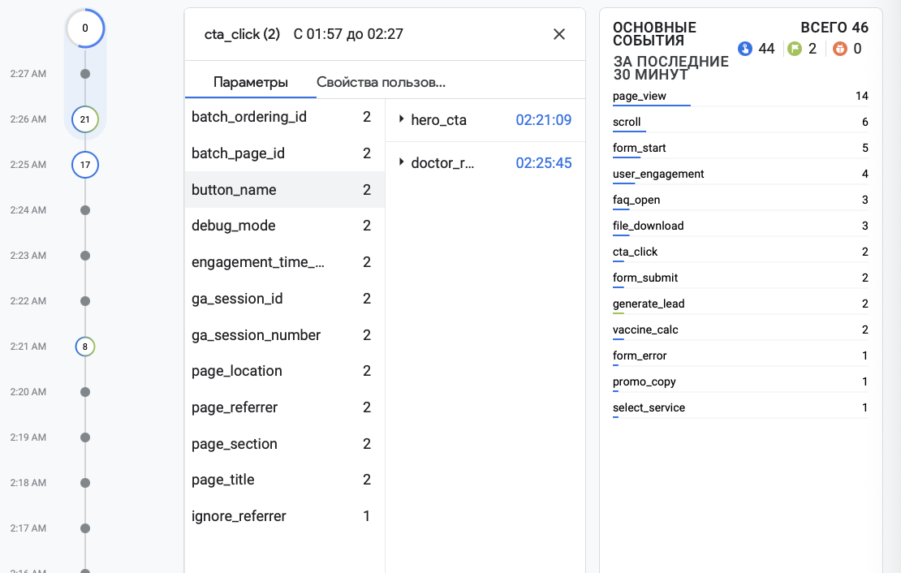

## 5. UTM-ссылки и соцсети

В реестре 12 ссылок, опубликованы в четырёх соцсетях (Instagram, ВКонтакте, Telegram,
YouTube), у двух партнёров и на афише с QR-кодом.

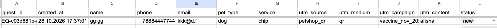
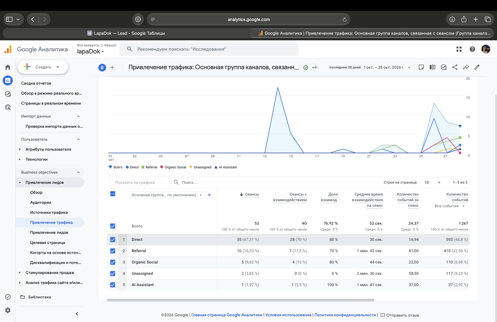

## 6. Заявки

Форма отправляет заявку в Apps Script, тот проверяет поля и записывает
строку в лист `leads` вместе с метками. Повторная отправка не создаёт дубль.

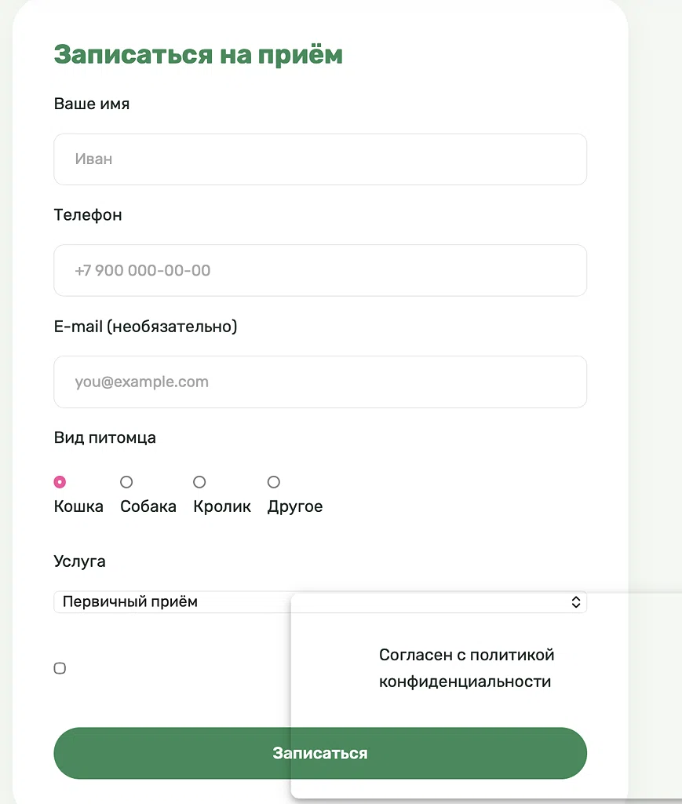
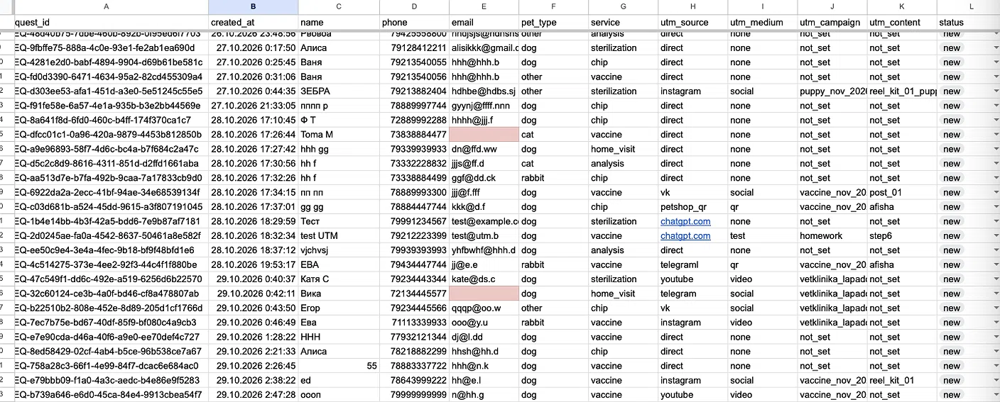

## 7. Автоответы в Instagram

Комментарий АПТЕЧКА под Reel запускает ответ в комментариях и сообщение
в Direct с кнопкой на сайт. Вторая ветка — слово ЩЕНОК.

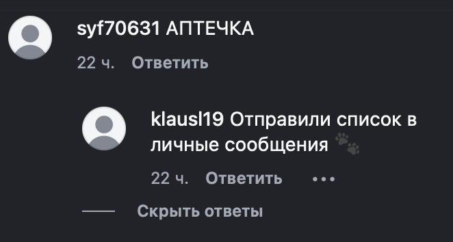
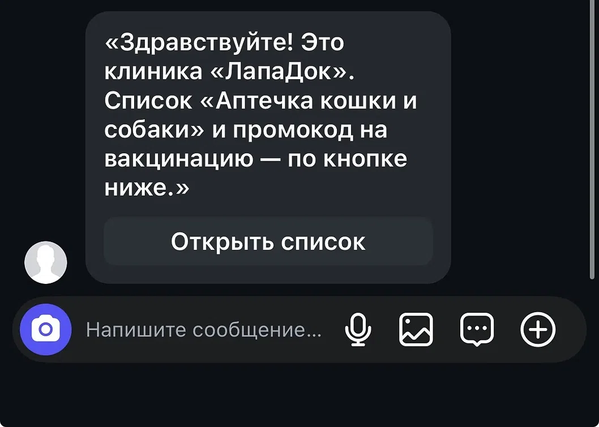

## 8. Отчёты и дашборд

Воронка показала наибольшую потерю между  входа на сайт (page_view) и выбором животного (pet_type_select).
Больше всего заявок принёс канал Instagram.

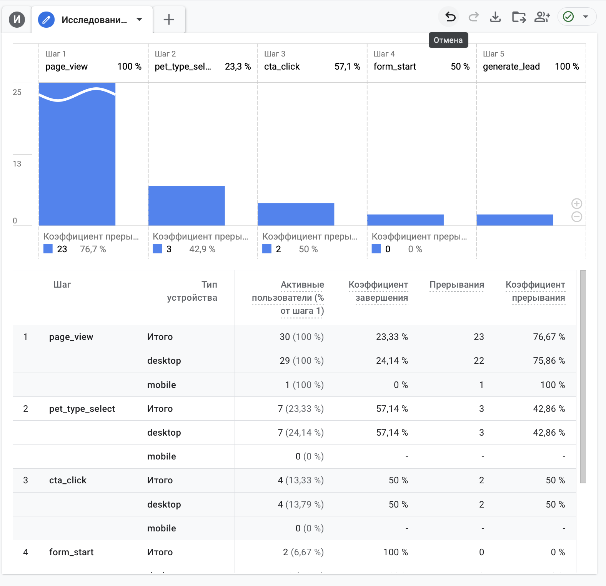
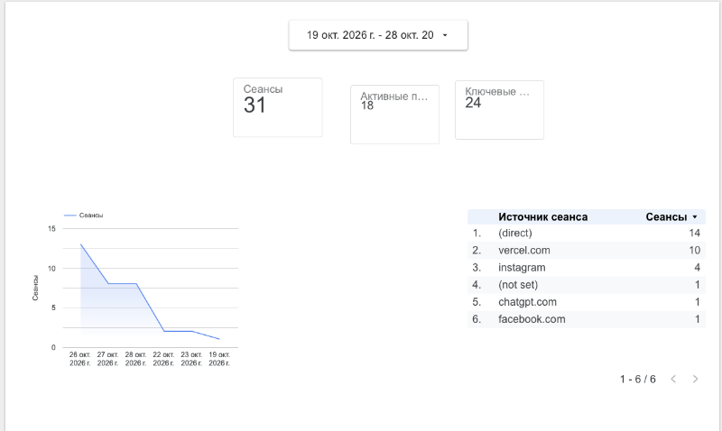

## 9. Что получил бизнес

| Было | Стало |
|---|---|
| заявки в личных сообщениях трёх аккаунтов | все заявки в одной таблице со статусом |
| источник клиента неизвестен | у каждой заявки есть source, medium, campaign |
| бюджет делится «по ощущениям» | на дашборде видно заявки по каждому каналу |
| ответы на комментарии вручную | ManyChat отвечает сразу и ведёт на сайт |

Рекомендация заказчику: На основе данных сквозной аналитики оценить окупаемость сотрудничества с блогерами-зоозащитниками (15 000 ₽ в месяц) и перераспределить высвободившийся бюджет в каналы с максимальной конверсией в подтверждённый приём. 

## 10. Итог

Не получилось: Настроить нативную интеграцию HubSpot CRM
ИИ использовался для: создания внешнего вида и структуры сайта, настройки проверки номеров телефонов и создания формул разделения ФИО на имя и фамилию.
