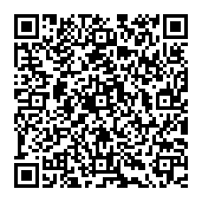

# Презентация к защите · план слайдов

Доклад — до 7 минут, 12 слайдов. Цель — показать работающий продукт
и пользу для бизнеса.

**Оформление:** цвета компании из ТЗ (#2E8B57, #F2B33D, #F5F8F4), шрифт Rubik, 
на слайде один тезис и один кадр или схема, шрифт не меньше 20 pt. 
Номер слайда в углу. Кадры обрезаны, ваш адрес сайта и Measurement ID на них видны.

| № | Слайд | Время |
|---|---|---|
| 1 | Титул | 0:15 |
| 2 | Проблема заказчика | 0:30 |
| 3 | Схема решения | 0:40 |
| 4 | Сайт | 0:40 |
| 5 | Путь заявки | 0:50 |
| 6 | Instagram → сайт | 0:40 |
| 7 | GA4: события и источники | 0:40 |
| 8 | Воронка | 0:40 |
| 9 | Дашборд Looker Studio | 0:45 |
| 10 | Что получил бизнес | 0:40 |
| 11 | Как помог ИИ и что было сложно | 0:30 |
| 12 | Ссылки | 0:10 |
## 1. Титул

**На слайде:** логотип компании, «Сайт и сквозная аналитика заявок для ветеринарной клиники «ЛапаДок»»,
ТЗ № ТЗ-06/2026, Кононова Ника, группа РПО3, ОП.03\
`[картинка: главная страница сайта на фоне, затемнённая]`

## 2. Проблема заказчика

**На слайде:** 3–4 числа из письма директора.

> 1 500 пациентов в месяц · 410 обращений в соцсетях · 154 записи · 40 000 ₽ в месяц на продвижение без понимания, что работает

**Говорю:** откуда шли заявки и почему клиника не знала, какой канал приводит клиентов.

## 3. Схема решения

`[картинка: docs/scheme.png]`

**Говорю:** путь посетителя — соцсеть или QR → сайт с метками → GA4 и таблица → дашборд.

## 4. Сайт

`[картинка: главная на компьютере + та же страница на телефоне]`
`[картинка: Lighthouse — три оценки]`

**На слайде:** 8 страниц (+404) · Vercel · Lighthouse 82 / 93 / 100 · создан с помощью DeepSeek.

## 5. Путь заявки

`[картинка: адрес страницы с UTM-метками]` → `[картинка: заполненная форма]` →
`[картинка: строка в листе leads с метками]` → `[картинка: generate_lead в Realtime]`

**Говорю:** одна заявка проходит весь путь, источник сохраняется в таблице.
Здесь — живой показ или видео до 60 секунд.

## 6. Instagram → сайт

`[картинка: комментарий «АПТЕЧКА» и автоответ]` · `[картинка: сообщение в Direct с кнопкой]`

**Говорю:** ManyChat отвечает сразу, кнопка ведёт на сайт по ссылке из реестра. Вторая ветка — «ЩЕНОК».

## 7. GA4: события и источники

`[картинка: Traffic acquisition по Session source / medium]`

**На слайде:** 20 событий · 7 параметров · ключевое событие — `generate_lead`. Все проверены в DebugView.

## 8. Воронка

`[картинка: воронка из Explore, 5 шагов]`

**На слайде:** наибольшая потеря — между `page_view` (вход на сайт) и `pet_type_select` (выбор животного) — 76,67%.
**Говорю:** гипотеза, почему теряются (возможно, не видят кнопку), и как её проверить (A/B тест).

## 9. Дашборд Looker Studio

`[картинка: вкладка «Кампании»: сеансы, заявки и успешные заявки по каналам]`

**Говорю:** руководитель открывает одну ссылку и видит, какой канал приводит клиентов.

## 10. Что получил бизнес

| Было | Стало |
|---|---|
| заявки в личных сообщениях трёх аккаунтов | все заявки в одной таблице со статусом |
| источник клиента неизвестен | у каждой заявки есть source, medium, campaign |
| бюджет делится «по ощущениям» | на дашборде видно заявки по каждому каналу |
| ответы на комментарии вручную | ManyChat отвечает сразу и ведёт на сайт |

**На слайде:** рекомендация — «Перенести 15 000 ₽ из блогеров-зоозащитников в Instagram, потому что он дал заявки с высокой конверсией».

## 11. Как помог ИИ и что было сложно

**На слайде:** 
* ИИ помог сверстать страницы, написать регулярки для проверки телефонов и формулы разделения ФИО.
* Вручную исправляла баги в скриптах.
* Не получилось: нативная интеграция HubSpot (сделали через CSV).

## 12. Ссылки

**На слайде:** 
* Сайт: https://tz-06-vetklinika-lapadok.vercel.app
* Репозиторий: https://github.com/nikaxzzl/tz-06-vetklinika-lapadok
* QR-код на репозиторий: 